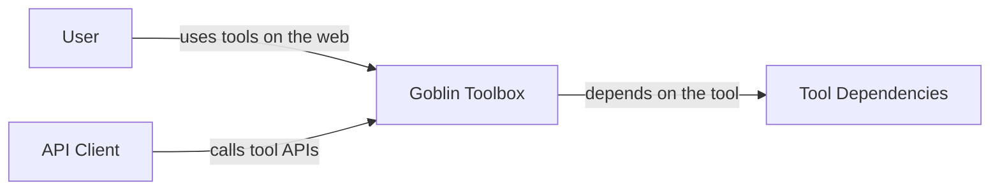
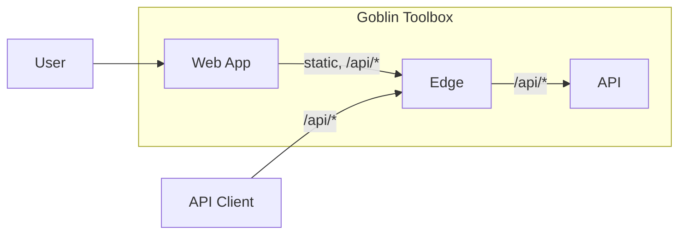
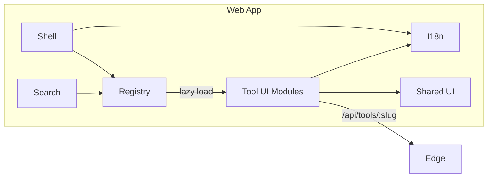
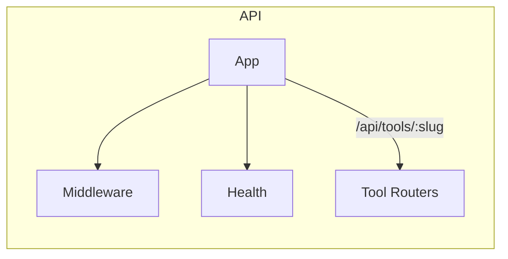
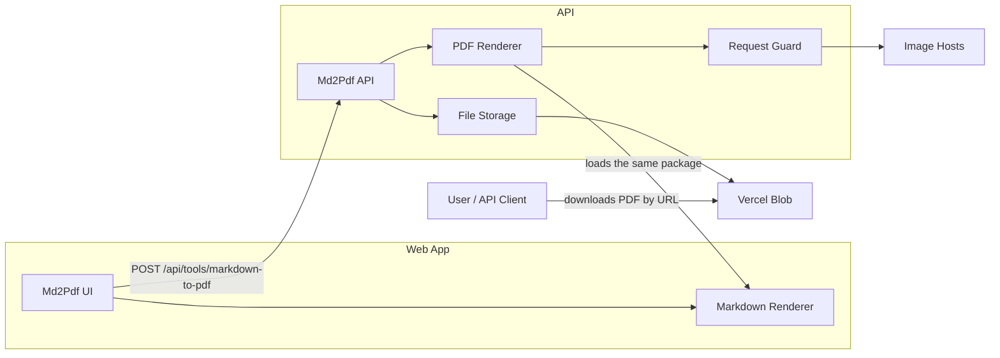

# PLAN: Goblin Toolbox

## 1. Idea and scope

Goblin Toolbox is a web app made of several **vaults**. Each vault groups **tools** on the same topic. Each tool has its own UI for direct use and its own API for other systems to call.

Sections 1–5 describe the **toolbox as a whole** and apply to every tool. Each tool has its own section describing its requirements, architecture and API. The MVP has one tool: **Markdown to PDF** (section 6).

### 1.1 Shared functional requirements

- The home page searches tools; choosing a tool opens the tool's own page.
- A vault page lists the tools in that vault.
- i18n in English and Vietnamese **for the UI only**; more locales can be added later. The API has no i18n.
- Adding a new tool does not require changing the app shell; the tool only registers itself in the registry.

### 1.2 Shared technical constraints

- One repo (npm workspaces), written in TypeScript.
- Frontend: React + Vite.
- Backend: Node.js + Express.
- Everything runs on **one Vercel project (Hobby)**: the static frontend is served by the Vercel CDN, and the API of every tool is one Express app running in a Vercel Function, on the same domain.
- Every API returns errors as JSON with a stable `code` and an English `message`. The UI translates based on `code`.
- Requests stay within the body limit of Vercel Functions.

## 2. Domain model

| Concept | Definition |
|---|---|
| **Project** | All of Goblin Toolbox: one app, one registry holding every vault and tool. |
| **Vault** | A group of tools on the same topic. It is only a category: no logic, permissions or API of its own. It has an `id`, a `slug`, a name and description per locale, and a display order. It has a page at `/vaults/:slug` listing its tools. |
| **Tool** | An independent feature belonging to exactly one vault. It has a UI at `/tools/:slug` and may have an API at `/api/tools/:slug`. A tool does not import code from another tool. Resources specific to a tool (storage, libraries, external services) are declared by the tool in its own section. |
| **Tool manifest** | The tool's metadata, declared in the frontend: `id`, `slug`, `vaultId`, i18n keys for name and description, keywords per locale, `hasApi`, lazy import of the UI. |
| **Registry** | The list of vaults and tool manifests in the frontend; the single source of data for the home page, search and vault pages. The backend registers routers under the same `slug`. `slug` is the key linking frontend and backend. |
| **Search** | Runs on the client over the registry. Matches names, descriptions and keywords in **every locale**. |

Checklist for adding a new tool, created and verified in Phase 2:

1. Create `frontend/src/modules/<slug>/` with the UI and `manifest.ts`, then register it in the registry.
2. Add the tool's i18n strings for every locale.
3. If it has an API: create `backend/src/tools/<slug>/` with `router.ts`, then register the router in `backend/src/app.ts`.
4. If the tool needs a package shared between its UI and API: create it in `packages/<name>/`.
5. Add a section describing the tool to `docs/INIT_PLAN.md` (including its own non-functional requirements), add tests and update the README.

## 3. Overall toolbox architecture (C4)

### C1: System Context



- **User**: a person using tools in the browser.
- **API Client**: an external system calling a tool's API.
- **Goblin Toolbox**: the system being built.
- **Tool Dependencies**: external systems a tool needs; each tool lists its own in its section.

### C2: Containers



- **Edge**: Vercel CDN and WAF; serves static files, applies rate limits, forwards `/api/*` to the API.
- **Web App**: React SPA running in the browser; holds the shell and the UI of every tool.
- **API**: Express app in a Vercel Function; holds the API of every tool.

### C3: Web App components



- **Shell**: layout, routing, locale switching, home page and vault pages.
- **Registry**: the list of vaults and tool manifests.
- **Search**: finds tools in the registry across every locale.
- **I18n**: UI strings per locale and the mechanism for adding locales.
- **Shared UI**: components shared by every tool.
- **Tool UI Modules**: each tool's own UI, one module per tool.

### C3: API components



- **App**: creates the Express app and mounts each tool's router by `slug`.
- **Middleware**: JSON parsing, request id, structured logging, `code` + `message` error format.
- **Health**: endpoint checking that the API is alive.
- **Tool Routers**: each tool's own API, one router per tool.

## 4. Directory structure

```text
.
├── CLAUDE.md                        # rules for Claude, imports docs/WORKFLOW.md
├── .claude/                         # Claude Code settings and lint/format hook
├── README.md                        # created in Phase 2
├── package.json                     # npm workspaces: frontend, backend, packages/*; lint, format, typecheck scripts
├── .oxlintrc.json, .prettierrc.json, .prettierignore
├── vercel.json                      # build, SPA fallback, rewrite /api/* → api/index.ts, function config, cron
├── .gitignore
├── .github/workflows/ci.yml         # lint, type check, test, build
├── api/
│   └── index.ts                     # Vercel Function entrypoint; exports the Express app from backend/
├── frontend/                        # React + Vite
│   ├── src/
│   │   ├── app/                     # shell, routing, home, vault page, search
│   │   ├── registry/                # vaults and the list of tool manifests
│   │   ├── modules/                 # each tool's UI
│   │   │   └── markdown-to-pdf/
│   │   ├── i18n/                    # en, vi, locale configuration
│   │   └── shared/                  # shared UI
│   └── dist/                        # build output, gitignored, served by Vercel CDN
├── backend/                         # Node.js + Express, API only
│   └── src/
│       ├── app.ts                   # creates the Express app, mounts middleware, health and tool routers
│       ├── dev-server.ts            # runs Express locally
│       ├── middleware/              # request id, logging, error format
│       └── tools/                   # each tool's API
│           └── markdown-to-pdf/
├── packages/                        # packages shared between a tool's UI and API
│   └── markdown-renderer/           # belongs to the Markdown to PDF tool (see section 6)
└── docs/
    ├── INIT_PLAN.md                 # initial plan (this document)
    ├── WORKFLOW.md                  # phase process, branches, commits, comments, imports, lint
    ├── phases/                      # description of each phase
    └── design/                      # Phase 1 output
```

## 5. Shared non-functional requirements

These apply to every tool. Each tool sets its own additional non-functional requirements when its build starts.

| Area | Requirement |
|---|---|
| Security | HTTPS only. Every API input is validated against a schema. |
| Privacy | Do not store content users send, unless the tool needs it and says so in its section. Do not log content; log only metadata (request id, size, duration, outcome). |
| Rate limit | Per IP, using Vercel WAF on `/api/*` (decided). Each tool's own thresholds are set in the phase that builds it. |
| Availability | Best effort, no SLA. |
| Browsers | The two latest versions of Chrome, Edge, Firefox, Safari. |
| Accessibility | Basic WCAG 2.1 AA: keyboard navigation, contrast, form labels, visible focus. |
| Observability | Vercel logs; structured logs, one line per request. |
| Source control and CI/CD | Git repo on GitHub. GitHub Actions runs lint, type check, test and build on every PR. Vercel Git integration: every PR gets a preview deployment, `main` deploys to production. |
| Rollback | Vercel Instant Rollback; frontend and API share one deployment, so they roll back together. |
| Cost | Stay within Hobby limits. Upgrade to Pro when commercial use is needed or limits are hit two months in a row. |

## 6. Tool: Markdown to PDF

Belongs to the **Document Tools** vault. The tool only outputs PDF.

### 6.1 Functional requirements

- Editor and live preview, split side by side on desktop.
- Input by typing/pasting or uploading a `.md` file.
- A button to reformat the Markdown in the editor.
- Supports basic Markdown/GFM, syntax highlighting per language, Mermaid, math formulas and images from public URLs.
- Inline HTML through an allowlist (e.g. `<sup>`, `<sub>`, `<kbd>`, `<br>`); tags outside the allowlist and scripts are removed.
- Download PDF; choose page size, orientation, margins, page numbers (on/off), font and theme. Fonts must fully support Vietnamese.
- Adjust text, heading and link colors and the heading style (H1–H3).
- The PDF matches the preview.
- The API accepts JSON with Markdown and options, generates the PDF and returns a download URL; the file is deleted after 1 hour.
- The API needs no authentication; it has a basic rate limit.

### 6.2 Technical constraints

- The PDF is generated by **Chromium** on the server: `puppeteer-core` + `@sparticuz/chromium`.
- Preview and PDF use **the same package `packages/markdown-renderer/`** and the same theme CSS. The options schema also lives in this package so the UI and API share it.
- PDFs are stored on **Vercel Blob** under random names. Blob does not expire files on its own, so files older than 1 hour are deleted by our own cleanup (see 6.6).
- The Markdown size limit is set after measuring.

### 6.3 Tool architecture

This section only describes what the tool adds to the overall architecture in section 3.

**Tool-specific dependencies**

- **Image Hosts**: external websites holding images the user embeds in Markdown by URL; we do not operate them.
- **Vercel Blob**: storage for generated PDFs so users can download them by URL; part of the same Vercel project.



- **Md2Pdf UI**: tool UI module; editor, `.md` upload, reformat, options, PDF download, error display.
- **Markdown Renderer**: `packages/markdown-renderer/`; Markdown → HTML with GFM, highlighting, KaTeX, Mermaid, sanitizing, theme CSS.
- **Md2Pdf API**: tool router; validates the request, orchestrates PDF generation, returns the URL.
- **PDF Renderer**: opens Chromium, loads the Markdown Renderer and theme, waits for Mermaid/KaTeX to finish, then prints the PDF.
- **Request Guard**: blocks Chromium requests to internal IPs or unexpected schemes; applies timeouts and image size limits.
- **File Storage**: uploads the PDF to Blob, returns the URL and `expiresAt`, deletes files older than 1 hour.

### 6.4 API

```http
POST /api/tools/markdown-to-pdf
Content-Type: application/json
```

```json
{
  "markdown": "# Hello\n\nDocument content",
  "options": {
    "pageSize": "A4",
    "orientation": "portrait",
    "margin": "default",
    "pageNumbers": true,
    "font": "default",
    "theme": "default",
    "colors": { "text": "#1f2328", "heading": "#0b3d91", "link": "#0969da" },
    "headingStyle": "default"
  }
}
```

- Valid values for each option are set in Phase 1. `colors` (`text`, `heading`, `link`) and `headingStyle` are **required**; colors accept hex codes only. The UI pre-fills them from the selected theme.

Successful response:

```json
{
  "url": "https://<store>.public.blob.vercel-storage.com/<random>.pdf",
  "expiresAt": "2026-11-21T10:00:00Z"
}
```

- Status codes and headers for each case are defined in the Phase 3 slice that implements that case.

### 6.5 Tool-specific non-functional requirements

Set at the start of Phase 3 (task M0.1), in addition to the shared non-functional requirements in section 5.

### 6.6 Decisions

1. **Preview and PDF match:** same Markdown Renderer, same theme CSS and fonts, pinned versions. Verified with fixtures: screenshot the preview in Chrome and compare it with an image rendered from the PDF.
2. **Unsafe content:** inline HTML is sanitized through an allowlist and user-supplied scripts never run; every Chromium request goes through the Request Guard.
3. **Local matches production:** pin the `@sparticuz/chromium` version. Locally, use the Chrome browser installed on the machine, same major version, because `@sparticuz/chromium` only runs on Linux. CI runs on Linux with the exact `@sparticuz/chromium` used in production, and the match test runs in CI.
4. **Delete PDFs after 1 hour:** every PDF request also deletes Blob files older than 1 hour; a daily Vercel Cron acts as a safety net. The spike verifies Hobby's cron limits.

## 7. Phase plan

Each phase has a task table (with dependencies), tests, review, AC and output. A phase starts only after the previous phase's AC has been reviewed and accepted.

Each phase runs according to `docs/WORKFLOW.md` (steps, branches, commits, comments, imports, lint). In addition:

- The git repo is initialized (branch `main`, with `.gitignore`).
- The initial commit contains `docs/INIT_PLAN.md`, `docs/phases/`, `docs/WORKFLOW.md`, `CLAUDE.md`, `.claude/` and `.gitignore`, made once the plan is final.
- Every phase's output is committed to the repo, including the Phase 1 documents (`docs/design/`).

| # | Phase | File |
|---|---|---|
| 1 | Design (spike first) | [phases/phase-1-design.md](phases/phase-1-design.md) |
| 2 | Scaffold and deploy empty project | [phases/phase-2-scaffold-and-deploy.md](phases/phase-2-scaffold-and-deploy.md) |
| 3 | Build Markdown to PDF (slices 3.0–3.6) | [phases/phase-3-build-markdown-to-pdf.md](phases/phase-3-build-markdown-to-pdf.md) |
| 4 | Deploy tool | [phases/phase-4-deploy-tool.md](phases/phase-4-deploy-tool.md) |
