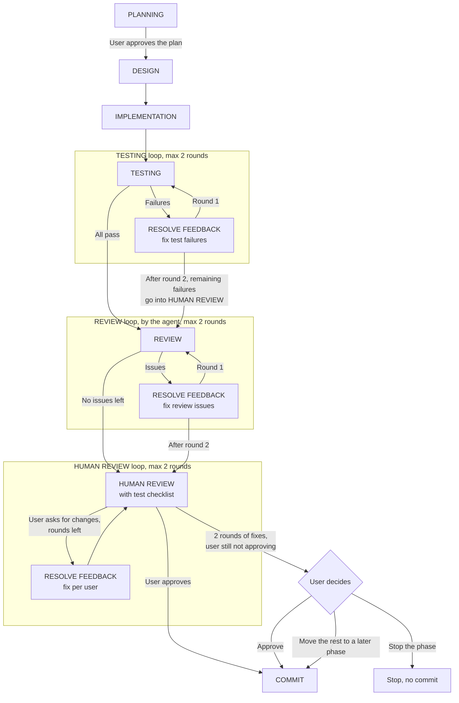

# PHASE WORKFLOW

This workflow applies to every phase of Goblin Toolbox. Shared functional requirements live in the root [README.md](../README.md), shared non-functional requirements in [docs/design/NFR.md](./design/NFR.md), tool requirements in `tools/<slug>/README.md`, and phase scope and tasks in `docs/phases/`. After IMPLEMENTATION come three loops in sequence, each with its own RESOLVE FEEDBACK step and a maximum number of rounds: TESTING (2 rounds), REVIEW done by the agent itself (2 rounds), HUMAN REVIEW (2 rounds).

## Diagram

## Steps

| Step | Work | Output | Condition to move on |
| :---- | :---- | :---- | :---- |
| PLANNING | Create the phase branch from `main`; read the phase file in `docs/phases/`, shared requirements in `README.md` and `docs/design/NFR.md`, and tool requirements in `tools/<slug>/README.md` when relevant; identify scope, tasks and open questions | Phase execution plan | User approves the plan |
| DESIGN | Design the API, modules and flows for the phase | The design; update the documents in `docs/design/` when the design changes, including the OpenAPI spec when a tool's API changes | Design matches the approved plan |
| IMPLEMENTATION | Write code by task ID, following the architecture in [docs/design/HLD.html](./design/HLD.html); every tool meets [docs/design/TOOL_CONTRACT.md](./design/TOOL_CONTRACT.md) | Code and tests for the phase | Every task of the phase is done |
| TESTING | Run automated tests, type check, build and every test item of the phase; lint and format pass. Phases that deploy also check the Vercel preview deployment | Result of each item, with failures if any | Every item passes, or 2 rounds are used |
| RESOLVE FEEDBACK (after TESTING) | Fix the failures from the TESTING round just run | Fixed code | Round 1: rerun TESTING. Round 2: go to REVIEW and record remaining failures for HUMAN REVIEW |
| REVIEW | The agent reviews the changes itself, without the user, against [docs/REVIEW_CHECKLIST.md](./REVIEW_CHECKLIST.md) | List of issues: unchecked best practices that apply and anti-patterns found | Empty list means go to HUMAN REVIEW |
| RESOLVE FEEDBACK (after REVIEW) | The agent fixes each issue and reruns the automated tests and affected test items | Fixed code, new test results | Round 1: review again. Round 2: go to HUMAN REVIEW |
| HUMAN REVIEW | Present to the user per section "HUMAN REVIEW content" | User's decision | User approves: go to COMMIT; user asks for changes: go to RESOLVE FEEDBACK |
| RESOLVE FEEDBACK (after HUMAN REVIEW) | Fix per the user's request, rerun related tests, present again | Fixed code, new test results | Back to HUMAN REVIEW. After 2 rounds of fixes without approval, the user decides: approve, move the rest to a later phase, or stop the phase |
| COMMIT | Commit with conventional commits on the phase branch, merge the branch into `main` and push | Phase merged into `origin/main` | Phase done |

### Counting rounds

- A round is one run of the main step (TESTING, REVIEW or HUMAN REVIEW) plus one RESOLVE FEEDBACK after it. The loop ends early when the main step has nothing left to fix.
- Every RESOLVE FEEDBACK reruns the related tests to confirm the fix; that rerun does not count as a new round.
- No extra loops once the rounds are used. Remaining failures or issues are not dropped: the agent lists them in HUMAN REVIEW for the user to decide.

## HUMAN REVIEW content

The agent presents all of the following in one message:

- **Changes:** summary by package (`host`, `packages/*`, `tools/*`) and by task ID.
- **Test results:** number of passing automated tests per package and the result of each phase test item, with evidence such as logs, API responses or deployment URLs.
- **Failures and issues fixed:** listed from the TESTING and REVIEW loops.
- **Still open:** failures not fixed when rounds ran out, known limitations, deviations from the plan.
- **User checklist (required):** a bullet list of what the user must check before approving. Each item states:
  - where: local with its URL, a preview deployment, or the Vercel production URL;
  - the clicks or commands to run, in order;
  - the expected result, so the user knows whether it passed.

  The user should never have to ask how to test. Items the agent has fully checked itself are left out of this list.
- **Planned commits:** the commit messages that will be used.

## Conventions

Code, API and UI rules are in [docs/conventions/](./conventions/).

## Branch and commit rules

- Each phase runs on its own branch created from `main`, named `phase/p<phase number>`, e.g. `phase/p2`.
- No direct commits to `main`.
- Never commit, merge or push before the user approves at HUMAN REVIEW.
- An approval for one commit, merge or push does not carry over to the next.
- Commit messages follow conventional commits, e.g. `feat(markdown-to-pdf): add page options`.
- Never commit secret files: tokens, keys, `.env`. The PreToolUse hook `.claude/hooks/block_secrets.py` blocks any `git add` or `git commit` that would stage one, by file name or by secret-looking content.
- Requirement and phase plan changes are committed together with the change that caused them; [README.md](../README.md), [docs/design/NFR.md](./design/NFR.md), `tools/<slug>/README.md` and `docs/phases/` always match the code on `main`.

## Deployment docs

- [docs/DEPLOY_RUNBOOK.md](./DEPLOY_RUNBOOK.md) is the DevOps guide for the project as it is now: local stack, deploy, environment variables, functions, cron jobs, caching, firewall, logs and rollback. It holds no history and nothing specific to one tool: a tool's variables, function settings and cron jobs are in its `tools/<slug>/README.md`, section "Operations". Update these in the same change that alters them.
- What a phase checked in production (deployment URLs, smoke checks, cron, rollback drill, findings) is recorded in that phase's file in `docs/phases/`, under `## Verification`. Production checks run after the push, so their record goes in a follow-up docs commit that needs its own approval.

## Blocked commands

- If a command cannot run because of environment access, network, DNS, credentials, or an unavailable tool, say so plainly and ask the user to run the exact command or provide the specific access needed.
- Do not send the user through speculative settings changes, mirrors, or workarounds. Do not claim a permission change will fix a failure unless the failure confirms that.
- After a failed attempt, report the concrete error and stop retrying unless a clear, safe diagnostic step can distinguish the cause.
