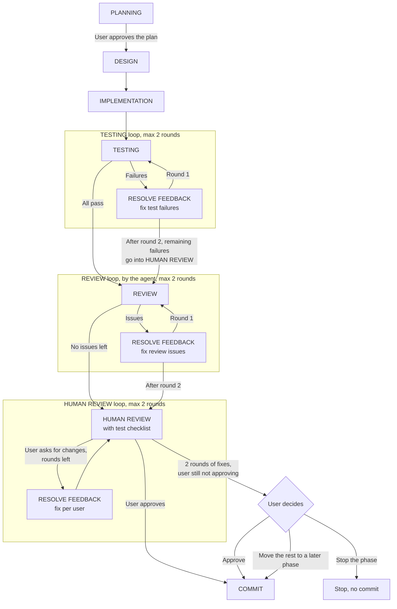

# PHASE WORKFLOW

This workflow applies to every phase of Goblin Toolbox. Shared functional requirements live in the root `README.md`, shared non-functional requirements in `docs/design/NFR.md`, tool requirements in `tools/<slug>/README.md`, and phase scope and tasks in `docs/phases/`. After IMPLEMENTATION come three loops in sequence, each with its own RESOLVE FEEDBACK step and a maximum number of rounds: TESTING (2 rounds), REVIEW done by the agent itself (2 rounds), HUMAN REVIEW (2 rounds).

## Diagram

## Steps

| Step | Work | Output | Condition to move on |
| :---- | :---- | :---- | :---- |
| PLANNING | Create the phase branch from `main`; read the phase file in `docs/phases/`, shared requirements in `README.md` and `docs/design/NFR.md`, and tool requirements in `tools/<slug>/README.md` when relevant; identify scope, tasks and open questions | Phase execution plan | User approves the plan |
| DESIGN | Design the API, modules and flows for the phase | The design; update the documents in `docs/design/` when the design changes, including the OpenAPI spec when a tool's API changes | Design matches the approved plan |
| IMPLEMENTATION | Write code by task ID, following the vault/tool model and rules in `docs/design/HLD.md` | Code and tests for the phase | Every task of the phase is done |
| TESTING | Run automated tests, type check, build and every test item of the phase; lint and format pass (section "Lint and format"). Phases that deploy also check the Vercel preview deployment | Result of each item, with failures if any | Every item passes, or 2 rounds are used |
| RESOLVE FEEDBACK (after TESTING) | Fix the failures from the TESTING round just run | Fixed code | Round 1: rerun TESTING. Round 2: go to REVIEW and record remaining failures for HUMAN REVIEW |
| REVIEW | The agent reviews the changes itself, without the user: meets requirements, security, the boundary between toolbox and tool, comment and language rules, import rules, no secret files | List of issues | Empty list means go to HUMAN REVIEW |
| RESOLVE FEEDBACK (after REVIEW) | The agent fixes each issue and reruns the automated tests and affected test items | Fixed code, new test results | Round 1: review again. Round 2: go to HUMAN REVIEW |
| HUMAN REVIEW | Present to the user per section "HUMAN REVIEW content" | User's decision | User approves: go to COMMIT; user asks for changes: go to RESOLVE FEEDBACK |
| RESOLVE FEEDBACK (after HUMAN REVIEW) | Fix per the user's request, rerun related tests, present again | Fixed code, new test results | Back to HUMAN REVIEW. After 2 rounds of fixes without approval, the user decides: approve, move the rest to a later phase, or stop the phase |
| COMMIT | Commit with conventional commits on the phase branch, merge the branch into `main` and push | Phase merged into `origin/main` | Phase done |

### Counting rounds

- A round is one run of the main step (TESTING, REVIEW or HUMAN REVIEW) plus one RESOLVE FEEDBACK after it. The loop ends early when the main step has nothing left to fix.
- Every RESOLVE FEEDBACK reruns the related tests to confirm the fix; that rerun does not count as a new round.
- No extra loops once the rounds are used. Remaining failures or issues are not dropped: the agent lists them in HUMAN REVIEW for the user to decide.

## HUMAN REVIEW content

The agent presents all of the following in one message:

- **Changes:** summary by package (`frontend`, `backend`, `tools/*`) and by task ID.
- **Test results:** number of passing automated tests per package and the result of each phase test item, with evidence such as logs, API responses or deployment URLs.
- **Failures and issues fixed:** listed from the TESTING and REVIEW loops.
- **Still open:** failures not fixed when rounds ran out, known limitations, deviations from the plan.
- **User checklist (required):** a bullet list of what the user must check before approving. Each item states:
  - where: local with its URL, a preview deployment, or the Vercel production URL;
  - the clicks or commands to run, in order;
  - the expected result, so the user knows whether it passed.

  The user should never have to ask how to test. Items the agent has fully checked itself are left out of this list.
- **Planned commits:** the commit messages that will be used.

## Branch and commit rules

- Each phase runs on its own branch created from `main`, named `phase/p<phase number>`, e.g. `phase/p2`.
- No direct commits to `main`. The only exception: the repo's initial commit containing `README.md`, `docs/design/NFR.md`, `docs/phases/`, `docs/WORKFLOW.md`, `CLAUDE.md`, `.claude/` and `.gitignore`, made after the user finalizes the plan.
- Never commit, merge or push before the user approves at HUMAN REVIEW.
- An approval for one commit, merge or push does not carry over to the next.
- Commit messages follow conventional commits, e.g. `feat(markdown-to-pdf): add page options`.
- Never commit secret files: tokens, keys, `.env`.
- Requirement and phase plan changes are committed together with the change that caused them; `README.md`, `docs/design/NFR.md`, `tools/<slug>/README.md` and `docs/phases/` always match the code on `main`.

## Markdown file naming

- Name Markdown files with `UPPERCASE_UNDERSCORE` (for example, `PROJECT_STRUCTURE.md` or `P1_DESIGN.md`).
- Keep conventional entry point names such as `README.md` as `README.md`.

## Comment and language rules

- Applies to every file except `.md`: source code, tests, scripts, config, `.gitignore`, `.env.example`.
- Comments go only at the top of a file, in one header block. No comments between lines of code: no end-of-line comments, no JSDoc on functions or classes, no JSX `{/* */}` comments, no `// eslint-disable` or `// oxlint-disable`.
- Required first lines such as a `#!` shebang stay on line 1; the header goes right after. JSON files have no comments.
- Comments are written in English.
- Comment only when the code cannot speak for itself, i.e. to answer "why" or to warn about something easy to break:
  - A technical limit not visible from the code, e.g. `@sparticuz/chromium` only runs on Linux.
  - A security or privacy decision that looks like dead code, e.g. re-checking the IP after every redirect in the Request Guard.
  - A contract between modules that the function signature does not show, e.g. the Markdown Renderer must behave the same in the browser and in Chromium.
  - A data format or trick that is easy to delete by mistake, e.g. an import that only registers a tool's router.
  - How to use a script or config file.
- Do not comment to:
  - Describe what a file does when the file and function names already say it.
  - Narrate the code, e.g. list function names.
  - Record plans or change history; those belong in the requirement documents, `docs/phases/` and git.
  - Repeat content already in `docs/design/` or other documents.
  - Summarize a test when its name already says enough.
- System messages are in English: exceptions, config errors, CLI and script output, logs, the `message` in API error responses.
- User-facing UI text always goes through i18n (`en`, `vi`); never hard-code strings in components. API errors reach the UI by `code`; the UI layer turns the `code` into a sentence in the current locale.

## Import rules

- Inside every package (`frontend`, `backend`, each `tools/<slug>`): imports of the package's own files use Node.js subpath imports `#/`, declared in that package's `package.json` as `"imports": { "#/*": "./src/*" }`, e.g. `#/shared/components/index.ts`, including `@import` in CSS. No relative `./` or `../` paths.
- Other packages are imported by package name and export, e.g. `@goblin/tool-<slug>/api`, never by a path into the package folder. See `docs/design/PROJECT_STRUCTURE.md`, section "Imports".
- A tool package never imports another tool package.

## Lint and format

| Scope | Lint | Format | Type check | Config |
| :---- | :---- | :---- | :---- | :---- |
| `frontend`, `backend`, `tools/*`, `api/` | `pnpm lint` (oxlint) | `pnpm format` (Prettier) | `pnpm typecheck` (`tsc -b`) | `.oxlintrc.json` and the `prettier` key in `package.json`, at the repo root |

- The Claude Code Stop hook (`.claude/settings.json`, script `.claude/hooks/lint_format.py`) runs automatically when the agent finishes a turn: it fixes lint and formatting in files changed in git. If lint errors cannot be fixed automatically, the hook hands them back to the agent once, then only reports them to the user.
- The hook only runs once oxlint and Prettier are installed at the repo root (from Phase 2); before that it does nothing.
- `.md` files are not formatted.
