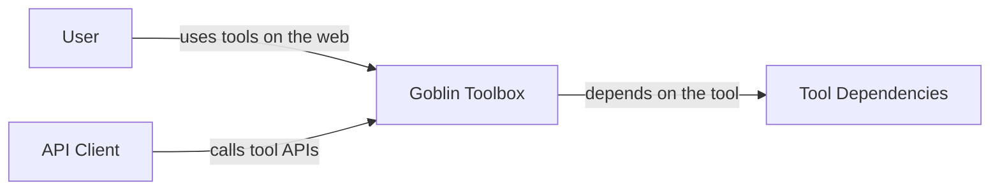
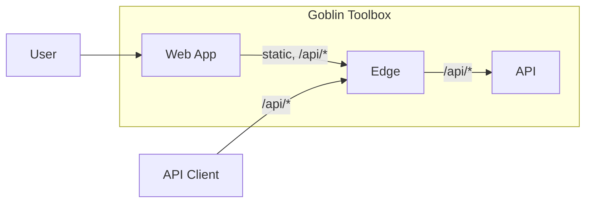
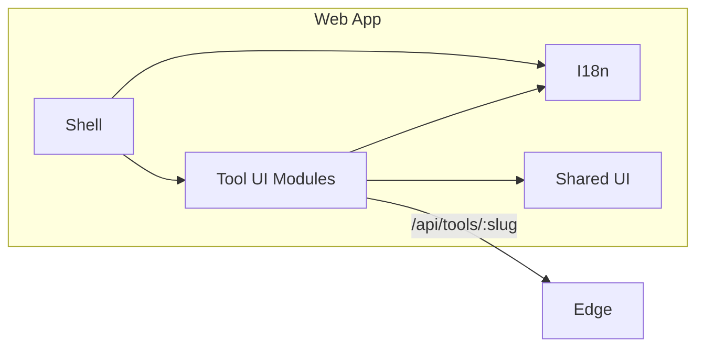
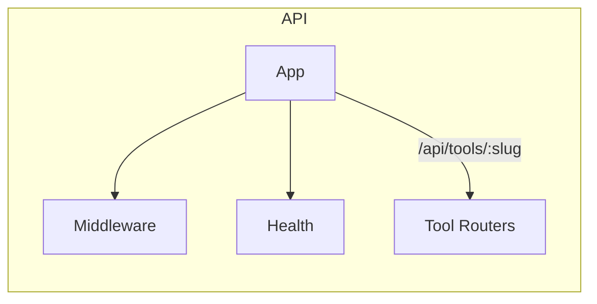
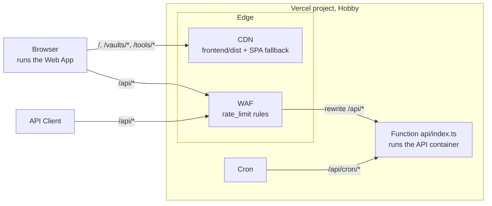

# High-level design: Goblin Toolbox

This document covers the toolbox platform only: the parts every tool shares. It implements the shared requirements in the root [README.md](../../README.md) and [docs/design/NFR.md](./NFR.md). Each tool's own requirements live in `tools/<slug>/README.md`; its technical documents live in `tools/<slug>/docs/` and must fit the rules here.

## Domain model

| Concept | Definition |
|---|---|
| **Tool** | A module with a UI and a set of APIs for interaction. |
| **Vault** | A group of tools in the same category. |

## Architecture (C4)

The "Deployment view" section shows how these containers map onto Vercel.

### C1: System Context

- **User**: a person using tools in the browser.
- **API Client**: an external system calling a tool's API.
- **Goblin Toolbox**: the system being built.
- **Tool Dependencies**: external systems a tool needs; each tool lists its own in its design.

### C2: Containers

- **Edge**: Vercel CDN and WAF; serves static files, applies rate limits, forwards `/api/*` to the API.
- **Web App**: React SPA running in the browser; holds the shell and the UI of every tool.
- **API**: Express app in a Vercel Function; holds the API of every tool.

### C3: Web App components

- **Shell**: layout, routing, locale switching, home page and vault pages (`frontend/`).
- **I18n**: UI strings per locale and the mechanism for adding locales.
- **Shared UI**: components shared by every tool.
- **Tool UI Modules**: each tool's own UI, the `./ui` export of its package `tools/<slug>/`.

### C3: API components

- **App**: creates the Express app and mounts each tool's router by `slug` (`backend/`).
- **Middleware**: request id, JSON parsing, structured logging, 404 and error handling in the `code` + `message` format.
- **Health**: endpoint checking that the API is alive.
- **Tool Routers**: each tool's own API, the `./api` export of its package `tools/<slug>/`.

### Deployment view

- **Web App** is built to `frontend/dist`, served by the CDN, and runs in the browser.
- **Edge** is Vercel's CDN and WAF; the SPA fallback sends any non-file path outside `/api/` to `index.html`.
- **API** runs as one Vercel Function holding every tool's router. Tools do not get separate functions for now; the limit and the split path are in [docs/design/PROJECT_STRUCTURE.md](./PROJECT_STRUCTURE.md), section "Scaling limit of one function".
- **Function settings** (memory, `maxDuration`, `includeFiles`) are set to the largest need declared by any tool.
- **Region:** one function region for the whole toolbox. Phase 2 compares `iad1` and `sin1` health latency and selects `sin1` for the Vietnam audience.
- **Cron** calls `/api/cron/*` for tools that declare scheduled jobs.
- **Tool dependencies** (storage, external services, bundled files) are declared in each tool's design and added when the tool is built.

## API conventions

| Topic | Rule |
|---|---|
| Paths | `/api/tools/<slug>/...` for tool APIs; `/api/health`; `/api/cron/<slug>-<job>` for scheduled jobs |
| Format | JSON in, JSON out, unless a tool's design says otherwise |
| Validation | Every request body is validated against a schema before the handler runs |
| Errors | `{ "code": string, "message": string }`; `code` stable and listed in the tool's OpenAPI; `message` in English |
| Unknown routes | `404` with `code: "NOT_FOUND"` |
| Unexpected failures | `500` with `code: "INTERNAL_ERROR"`; details only in logs |
| Rate limiting | Vercel WAF answers `429` itself, without the JSON body; clients must handle that case |
| Body size | Request bodies stay under the Vercel Functions limit (~4.5 MB, measured in spike 0001); above it Vercel answers `413` itself, without the JSON body |
| Cron | `/api/cron/*` requires `Authorization: Bearer $CRON_SECRET` |
| Docs | Each tool with an API keeps `tools/<slug>/docs/openapi.yaml` |

Shared middleware (in order): request id, JSON body parsing, structured request log (method, path, status, duration, request id; never bodies), tool routers, 404 handler, error handler.

## Frontend conventions

- Routes: `/`, `/vaults/:slug`, `/tools/:slug`; unknown paths show a not-found page.
- The shell owns shared layout, locale switch and error boundaries; a tool UI never renders outside its route.
- A tool calls only its own API under `/api/tools/<slug>`.
- API errors are shown by `code`, translated by the tool's i18n namespace; `429` and network failures have shared messages in the shell.

## Adding a tool

Verified with a fake tool in Phase 2.

1. Add the tool's requirements to `tools/<slug>/README.md`; define phase checks and acceptance criteria in the phase plan.
2. Write `tools/<slug>/docs/` before building, including decisions, OpenAPI when the tool has an API, and any extra dependencies or function settings it needs.
3. Create `tools/<slug>/` (`@goblin/tool-<slug>`) with its UI, API and i18n strings ([docs/design/PROJECT_STRUCTURE.md](./PROJECT_STRUCTURE.md), section "Packages (pnpm workspaces)"). Declare its own runtime dependencies in its `package.json`, and add it as a workspace dependency of `frontend` or `backend` where needed. Never import another tool.
4. Export the UI from `@goblin/tool-<slug>/ui` and register it in `frontend/src/app/registry.ts` with its lazy UI, vault, translated name, description and search keywords. Export an Express router from `@goblin/tool-<slug>/api` and mount it in `backend/src/tools.ts` under `/api/tools/<slug>` when the tool has an API.
5. Keep tool UI text in the tool's locale files and shared shell text in `frontend/src/i18n/locales/<locale>/common.json`. Add tests and update the tool README and OpenAPI document when its API changes.
6. Declare required environment variables, bundled files, memory, duration and cron needs in the tool docs. If the tool raises the function's memory, duration or bundle size, record the new values in [docs/design/PROJECT_STRUCTURE.md](./PROJECT_STRUCTURE.md).
7. If it needs scheduled work, add a cron under `/api/cron/<slug>-<job>`.

## Tool designs

Each tool's requirements live in `tools/<slug>/README.md` and its technical documents live in `tools/<slug>/docs/`; this document does not list tools.
