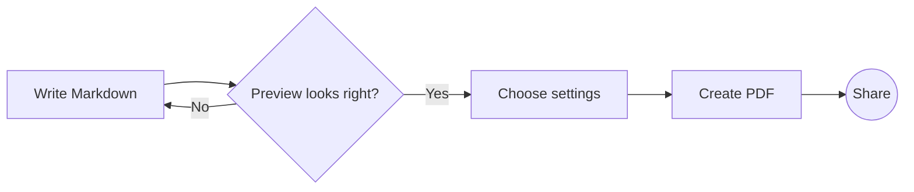
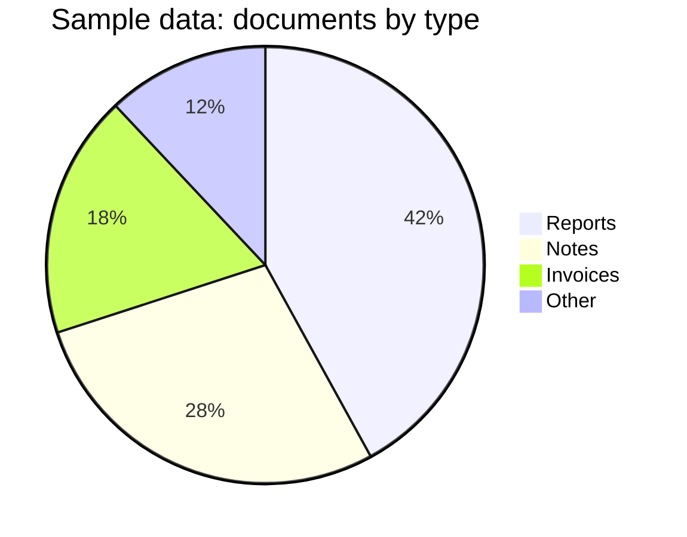
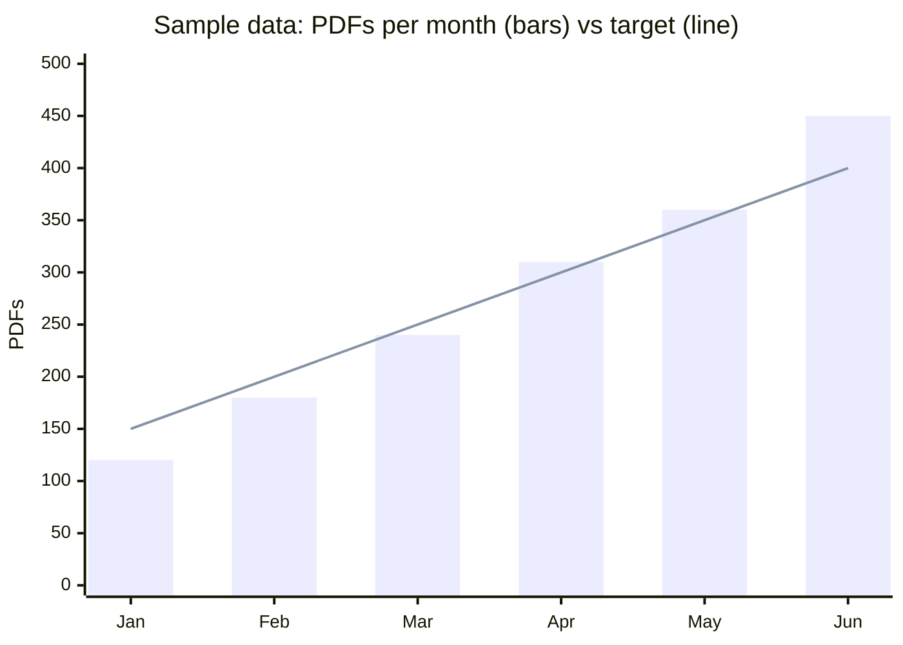

# Markdown to PDF

Turn plain **Markdown** into a clean, print-ready *PDF*. Edit this text on the left and the
preview on the right updates as you type. Everything below is ~~fake~~ sample content you can
replace — use `Upload .md` or drop a `.md` file onto the editor to open your own.

> **Tip:** Open **Settings** to pick a document style, page size, margins and page numbers.
> The preview follows every change.

## 1. Text formatting

Paragraphs support **bold**, *italic*, ***both***, ~~strikethrough~~, `inline code` and
[links](https://commonmark.org). Line breaks inside a paragraph are joined, so you can wrap
long sentences in the editor without changing the output.

### Lists

- Unordered lists use `-`, `*` or `+`
  - Nested items are indented by two spaces
  - They can go several levels deep
- Mixed content works too: **bold**, `code`, [links](https://example.com)

1. Write your document in Markdown
2. Choose a style in **Settings**
3. Click **Create PDF**

### Task list

- [x] Frontmatter shown as a table
- [x] Tables, code and math
- [x] Diagrams and charts
- [ ] Your own content

## 2. Tables

Common paper sizes:

| Size   | Width (mm) | Height (mm) |   Common use    |
| :----- | ---------: | ----------: | :-------------: |
| A4     |        210 |         297 | Most countries  |
| A5     |        148 |         210 |  Booklets, notes |
| Letter |      215.9 |       279.4 | US and Canada   |
| Legal  |      215.9 |       355.6 |   US contracts  |

## 3. Code

```typescript
type PdfOptions = {
  pageSize: 'A4' | 'Letter';
  orientation: 'portrait' | 'landscape';
  pageNumbers: boolean;
};

export function describe(options: PdfOptions): string {
  const numbers = options.pageNumbers ? 'with page numbers' : 'without page numbers';
  return `${options.pageSize} ${options.orientation}, ${numbers}`;
}
```

```bash
curl -X POST /api/tools/markdown-to-pdf \
  -H 'content-type: application/json' \
  -d '{"markdown": "# Hello"}'
```

## 4. Math

Inline math such as $E = mc^2$ sits in the text. Display math gets its own line:

$$
\int_{0}^{\infty} e^{-x^2}\,dx = \frac{\sqrt{\pi}}{2}
\qquad
\sum_{k=1}^{n} k = \frac{n(n+1)}{2}
$$

## 5. Diagrams



## 6. Charts





---

*Made with Goblin Toolbox. Replace this sample with your own Markdown to get started.*
