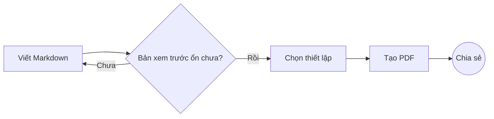
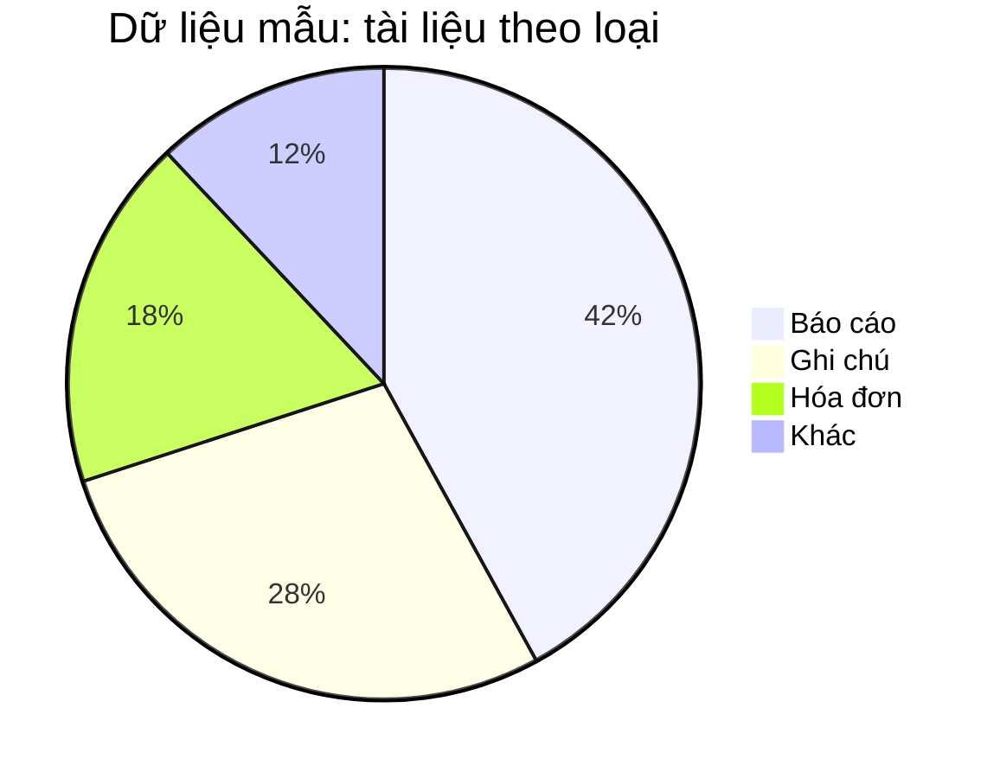
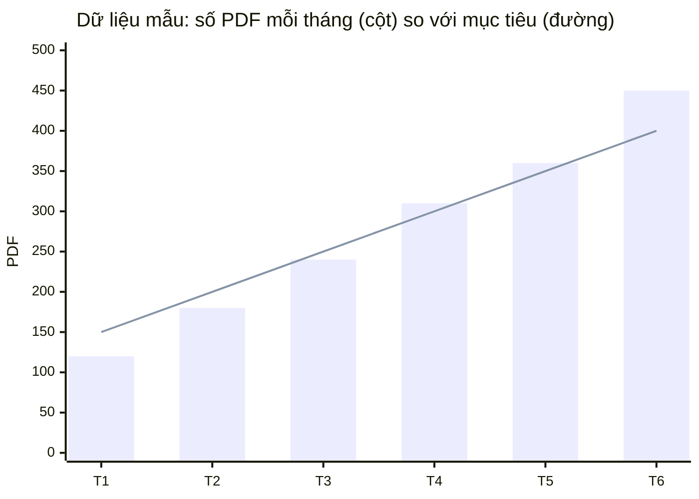

# Markdown sang PDF

Biến **Markdown** thành tệp *PDF* gọn gàng, sẵn sàng để in. Sửa nội dung bên trái, bản xem
trước bên phải cập nhật ngay khi bạn gõ. Mọi thứ bên dưới chỉ là nội dung ~~thật~~ mẫu để bạn
thay thế — bấm `Tải tệp .md` hoặc thả tệp `.md` vào trình soạn thảo để mở tài liệu của bạn.

> **Mẹo:** Mở **Thiết lập** để chọn kiểu tài liệu, khổ giấy, lề và số trang.
> Bản xem trước đổi theo mọi thay đổi.

## 1. Định dạng chữ

Đoạn văn hỗ trợ **in đậm**, *in nghiêng*, ***cả hai***, ~~gạch ngang~~, `mã trong dòng` và
[liên kết](https://commonmark.org). Xuống dòng bên trong một đoạn sẽ được nối lại, nên bạn có
thể ngắt câu dài trong trình soạn thảo mà không đổi kết quả.

### Danh sách

- Danh sách không thứ tự dùng `-`, `*` hoặc `+`
  - Mục con thụt vào hai khoảng trắng
  - Có thể lồng nhiều cấp
- Nội dung kết hợp cũng được: **đậm**, `mã`, [liên kết](https://example.com)

1. Viết tài liệu bằng Markdown
2. Chọn kiểu trong **Thiết lập**
3. Bấm **Tạo PDF**

### Danh sách việc cần làm

- [x] Frontmatter hiển thị thành bảng
- [x] Bảng, mã nguồn và công thức toán
- [x] Sơ đồ và biểu đồ
- [ ] Nội dung của bạn

## 2. Bảng

Các khổ giấy thông dụng:

| Khổ    | Rộng (mm) | Cao (mm) |   Thường dùng    |
| :----- | --------: | -------: | :--------------: |
| A4     |       210 |      297 | Hầu hết các nước |
| A5     |       148 |      210 |  Sổ tay, tờ gấp  |
| Letter |     215,9 |    279,4 | Mỹ và Canada     |
| Legal  |     215,9 |    355,6 |   Hợp đồng ở Mỹ  |

## 3. Mã nguồn

```typescript
type PdfOptions = {
  pageSize: 'A4' | 'Letter';
  orientation: 'portrait' | 'landscape';
  pageNumbers: boolean;
};

export function describe(options: PdfOptions): string {
  const numbers = options.pageNumbers ? 'có số trang' : 'không có số trang';
  return `${options.pageSize} ${options.orientation}, ${numbers}`;
}
```

```bash
curl -X POST /api/tools/markdown-to-pdf \
  -H 'content-type: application/json' \
  -d '{"markdown": "# Xin chào"}'
```

## 4. Công thức toán

Công thức trong dòng như $E = mc^2$ nằm ngay trong câu. Công thức riêng dòng được căn giữa:

$$
\int_{0}^{\infty} e^{-x^2}\,dx = \frac{\sqrt{\pi}}{2}
\qquad
\sum_{k=1}^{n} k = \frac{n(n+1)}{2}
$$

## 5. Sơ đồ



## 6. Biểu đồ





---

*Tạo bằng Goblin Toolbox. Thay tài liệu mẫu này bằng Markdown của bạn để bắt đầu.*
